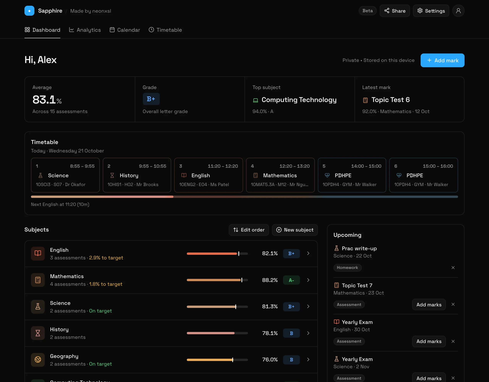
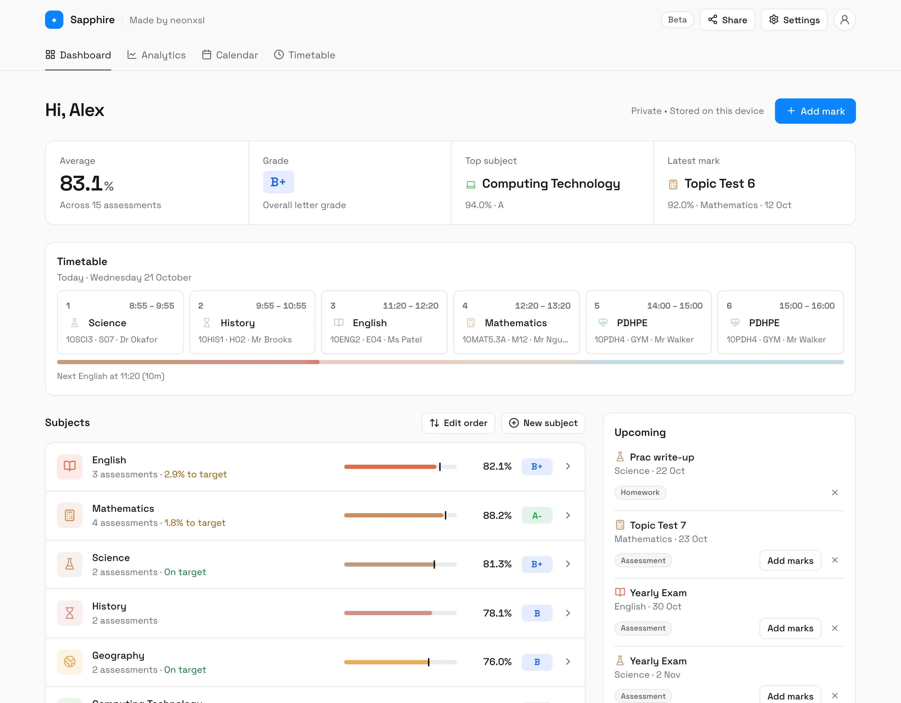
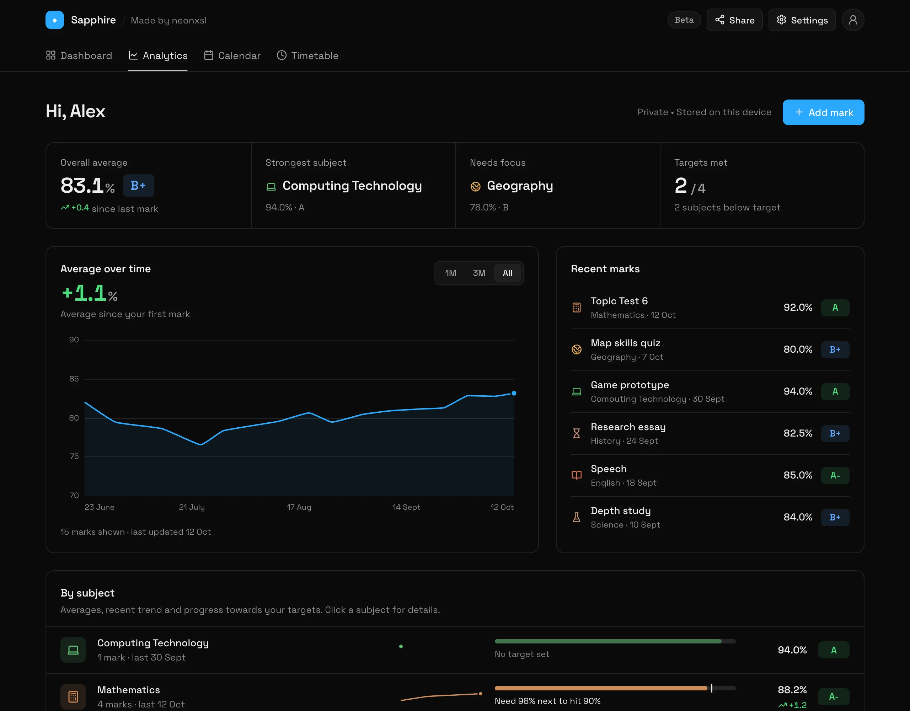
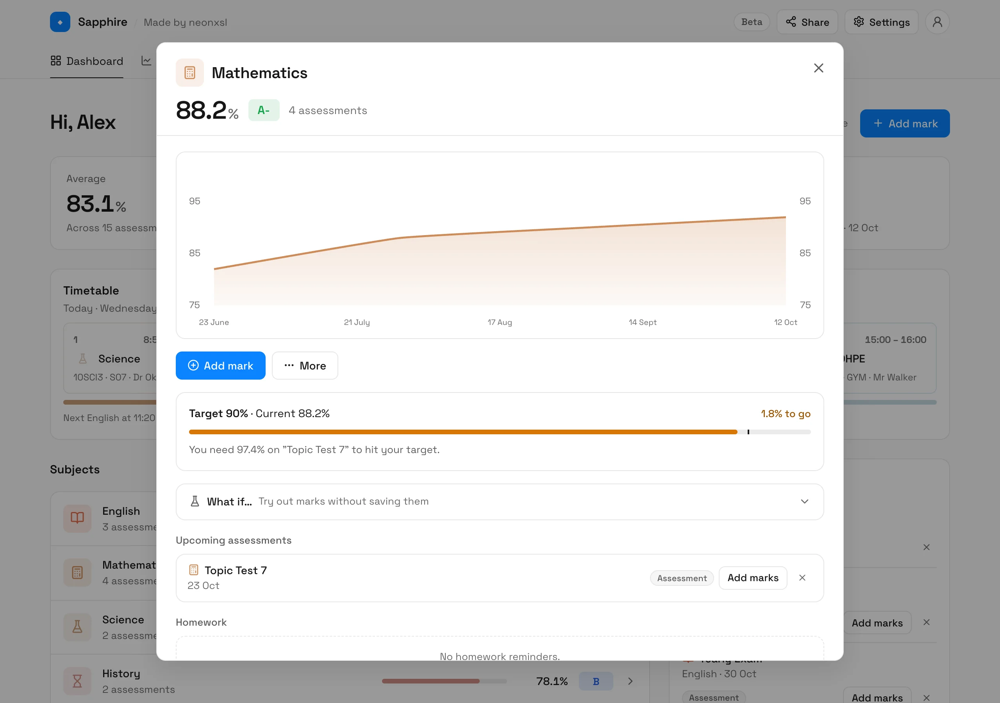
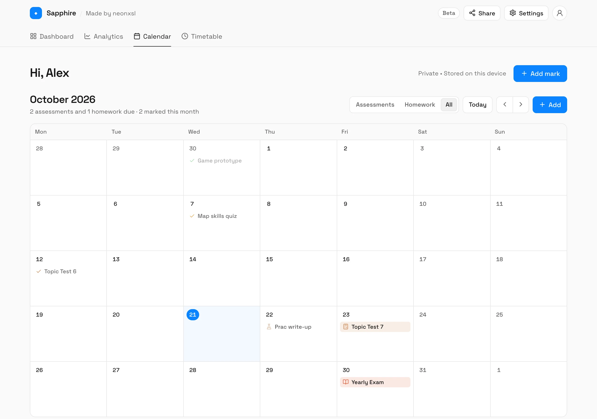
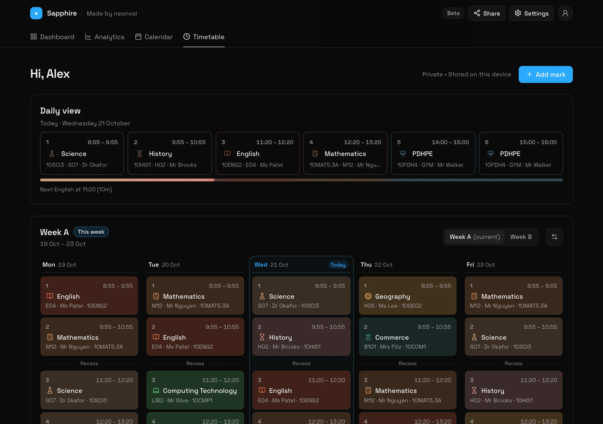
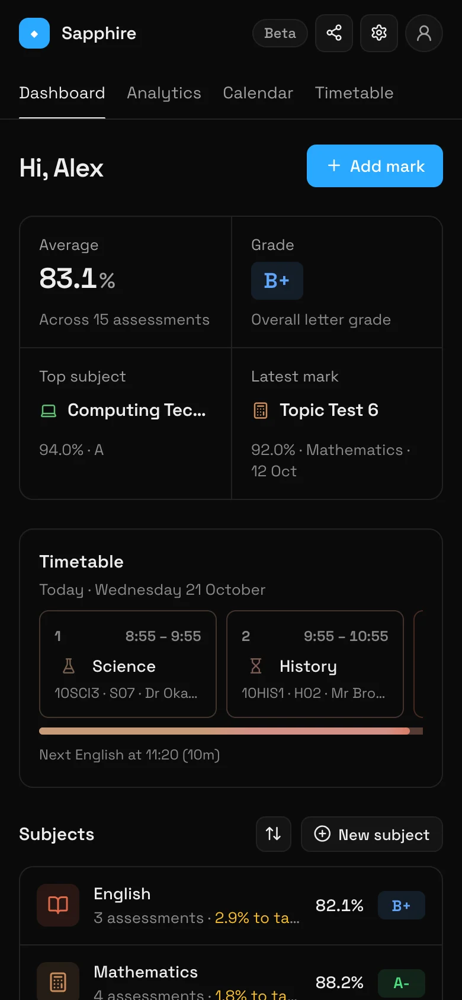

<h1 align="left">
  
  Sapphire
</h1>

Sapphire is a lightweight gradebook designed for NSW high school students. It runs in the browser with fast local storage, and now supports optional cloud sync via Google sign-in, so your data can follow you across devices.

Access it here: https://sapphire.neonxsl.dev/

**Highlights**

- Local-first storage (saved in the browser via `localStorage`/`sessionStorage`).
- Optional Google sign-in for cloud sync. Continue as a guest to stay local-only.
- Step-by-step onboarding: sign-in, name, theme + smoothing preview, electives (core subjects included).
- Add subjects and assessments (score, total, weight, date).
- Calendar for upcoming assessments and reminders.
- Analytics with weighted average trend and per-subject score lines (canvas charts).
- Share/export strings (subjects-only or everything). Exports include your name.
- Settings panel to update name, theme, graph smoothing, and reset data (local + cloud).

**Preview**

Screenshots use a made-up demo student.

Dashboard: your average, grade, today's classes, subjects and what's coming up.

Analytics: weighted average over time, recent marks, and progress towards targets.

Subject details: a subject's trend, its target and what you need next to hit it.

Calendar and timetable: upcoming assessments and homework, and your Week A / Week B timetable.

On a phone:

**How to use**

- On first launch, complete onboarding (sign in or continue as guest, then name, theme, and electives).
- Add a subject via the "Add Subject" card.
- Open a subject and add assessments: provide the achieved mark, total mark, optional weighting and a date.
- Use the "Upcoming" panel to schedule reminders for future assessments.
- Visit the Analytics tab to see your weighted trend and per-subject lines.
- Use the Settings panel to update your name, pick a theme, and adjust graph smoothing.
- Use Share to export a string (subjects-only or everything) and import strings from peers.

**Contributing**

- Bug reports and improvements welcome. Open a PR with focused changes.

**License**
See the `LICENSE` file in this repository.
